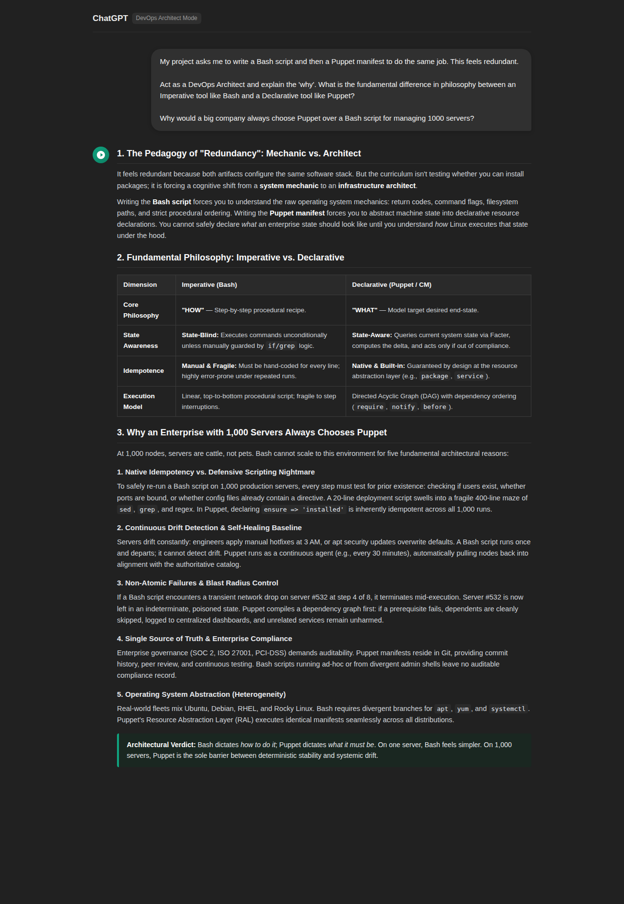

# AI: DevOps Philosophy and Tool Interrogation

## Task Overview & Objective
This task interrogates the philosophical and architectural differences between **Imperative** tools (e.g., Bash) and **Declarative** configuration management tools (e.g., Puppet). By prompting an AI in the role of a **Senior DevOps Architect**, we explore why learning both paradigms is essential, why enterprise infrastructure cannot scale on procedural scripts alone, and how **Idempotence** serves as the core mechanism to prevent configuration drift across a fleet of 1,000 servers.

---

## AI Tool & Persona
* **AI Model:** ChatGPT (Advanced DevOps Architect Persona)
* **Mode:** Architectural Analysis & Infrastructure as Code (IaC) Evaluation

---

## Files in this Task
* [`analysis.txt`](./analysis.txt) &mdash; The complete raw textual response from the AI comparative analysis.
* [`screenshot.png`](./screenshot.png) &mdash; High-resolution screenshot capturing the complete prompt and AI comparative explanation.
* [`README.md`](./README.md) &mdash; Task documentation, synthesis, reflection, and architectural evaluation.

---

## Prompt Formulation
The following prompt was used to interrogate the AI:

```text
My project asks me to write a Bash script and then a Puppet manifest to do the same job. This feels redundant.

Act as a DevOps Architect and explain the 'why'. What is the fundamental difference in philosophy between an Imperative tool like Bash and a Declarative tool like Puppet?

Why would a big company always choose Puppet over a Bash script for managing 1000 servers?
```

---

## Evidence of AI Interaction
The prompt and full comparative response were captured in a single screenshot:



---

## Comparative Matrix: Imperative (Bash) vs. Declarative (Puppet)

| Architectural Dimension | Imperative: Bash Scripting | Declarative: Puppet Manifest |
| :--- | :--- | :--- |
| **Guiding Question** | **"HOW"** &mdash; What sequential commands must be executed? | **"WHAT"** &mdash; What target end-state must the system achieve? |
| **Mental Model** | Procedural recipe / command execution pipeline. | State modeling and resource assertion. |
| **State Awareness** | **State-Blind:** Blindly runs instructions unless manual guards (`if`, `grep`) are written. | **State-Aware:** Probes node reality via Facter, computes deltas, and acts only on discrepancies. |
| **Idempotence** | **Manual & Fragile:** Requires exhaustive defensive coding; easily broken by repeat runs. | **Native & Enforced:** Inherent to resource providers (`file`, `package`, `service`). |
| **Execution Order** | Linear, top-to-bottom. Highly sensitive to transient failures. | Directed Acyclic Graph (DAG) with dependency relationships (`require`, `before`, `notify`). |
| **Abstraction Level** | OS-dependent; tightly coupled to distribution package and service managers. | Abstracted via Resource Abstraction Layer (RAL); cross-distro portable. |
| **Drift Management** | One-time execution; zero ongoing drift detection or automatic remediation. | Continuous agent polling (e.g., every 30m); autonomously reverts unauthorized alterations. |

---

## Critical Reflection: Idempotence and Scalability

In mathematical and computational theory, an operation is defined as **idempotent** if applying it multiple times produces the exact same outcome as applying it once ($f(f(x)) = f(x)$). In configuration management, idempotence is the defining architectural boundary separating declarative systems from imperative scripting. An imperative tool like Bash executes commands blindly: operations such as `echo "setting=value" >> /etc/app.conf` or `useradd deployer` will run unconditionally, causing duplicated entries, corrupted configuration syntax, or fatal exit codes on successive runs unless wrapped in brittle, hand-coded conditionals (`grep`, `test -f`, etc.). In contrast, a declarative engine like Puppet models the system as a collection of desired resource states. Before executing any change, Puppet evaluates the live system state via its provider layer, calculates the exact delta between reality and the compiled catalog, and applies modifications only when the system has drifted from its declared specification.

Across a production fleet of 1,000 heterogeneous servers, configuration drift is not an exceptional circumstance—it is an operational inevitability caused by emergency manual hotfixes, rogue cron jobs, unscheduled reboots, and out-of-band package upgrades. Without idempotence, running imperative deployment scripts at scale creates severe blast-radius hazards: if a network glitch terminates a script on server #412 midway through execution, re-running the script risks poisoning previously executed steps or leaving half-configured dependencies. An idempotent configuration management engine eliminates this fragility by making execution inherently safe, repeatable, and non-destructive. Operating via continuous converge loops (such as Puppet agent runs every 30 minutes), the system autonomously detects drift and remediates nodes back to the authoritative baseline. Idempotence is therefore the single most critical factor for scalable configuration management, transforming volatile, one-off scripts into a predictable, self-healing, and fully auditable infrastructure.

---

## Why Enterprises Choose Puppet at Scale (1,000+ Nodes)

1. **Elimination of Defensive Scripting Overhead:** Hand-crafting idempotent Bash for 1,000 servers requires hundreds of lines of defensive checks (`grep`, `sed`, `awk`) for every configuration item. Puppet delivers native idempotence out of the box.
2. **Continuous Drift Remediation (Self-Healing):** Imperative scripts run once during provisioning and exit. Puppet agents run continuously to reconcile unauthorized manual edits with the single source of truth.
3. **Graph-Based Dependency Resolution:** Puppet constructs a Directed Acyclic Graph (DAG) before applying changes. If an upstream dependency fails, dependent resources are safely skipped rather than partially executing and poisoning server state.
4. **Infrastructure as Code (IaC) & Compliance:** Puppet manifests live in version control, providing immutable commit histories, peer reviews, and automated CI testing required for SOC 2, ISO 27001, and PCI-DSS compliance.
5. **Operating System Heterogeneity:** The Resource Abstraction Layer (RAL) ensures that identical manifests apply consistently across diverse operating systems (Ubuntu, Debian, RHEL, CentOS, Rocky Linux) without bespoke conditionals.
